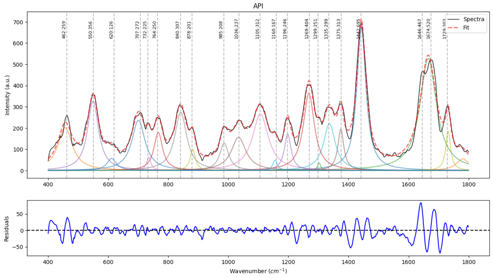
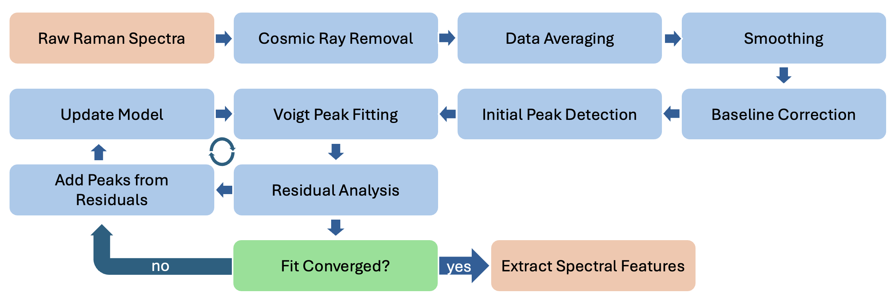

# RamanAnalyzer

[](./LICENSE)


A lightweight, single-file Python toolkit for Raman spectra: CSV parsing, cosmic-ray despiking,
averaging, baseline correction, wavelength → Raman-shift conversion, and iterative Voigt peak
fitting with [lmfit](https://lmfit.github.io/lmfit-py/).



**Who it is for:** people who want a small, readable preprocessing and peak-fitting pipeline built
on NumPy, SciPy, pandas and lmfit, rather than a full spectroscopy framework.

**Intended data:** freely and publicly available, non-personal spectra and synthetic examples.
Public availability is not a blanket data license, so follow the terms of each data source.
This is not a clinical or diagnostic tool.

## What it does



| Step | Function | Notes |
| --- | --- | --- |
| Parse | `raman_parser(file_path)` | Multi-trace CSV → list of DataFrames (`Wavenumber`, `Intensity`) |
| Despike | `despike_raman(df, moving_average, threshold=7, plot=False)` | Modified Z-score on first differences |
| Average | `average_raman(dfs, resolution=None, plot=False)` | Interpolates onto the shared x-range, then averages |
| Baseline | `estimate_baseline(df, lam=1e7, p=0.05, niter=3, plot=False)` | Asymmetric least squares (ALS); returns the corrected spectrum |
| Baseline (alt.) | `estimate_baseline_iarpls(df, lam=1e7, niter=50, epsilon=1e-6, plot=False)` | IarPLS variant; see [caveats](#caveats) |
| Crop | `cut_spectra(df, start=None, end=None)` | Keeps `start ≤ x ≤ end` and resets the index |
| Convert | `convert_wavelength_to_wavenumber(df, excitation_wavelength_nm)` | nm → Raman shift (cm⁻¹) |
| Fit | `fit_voigts(df, ...)` | Iterative Voigt fitting; returns an `lmfit` `ModelResult`, or `None` if no peaks are found |
| Plot | `plot_raman(df, title_prefix="Intensity Plot")` | Quick line plot |

`fit_voigts` finds peaks, fits one Voigt profile per peak, prunes peaks lower than about
`1.1 × min_height`, then repeatedly adds peaks found in the residual and refits. It stops when
the residual has no peaks above `threshold` or after `max_iterations` rounds. Helpers
`calculate_wavenumber_from_wavelength`, `voigt_height` and `voigt_amplitude_from_height` are also
exposed.

## Installation

RamanAnalyzer is a single module (`RamanAnalyzer.py`), not a pip package. Clone the repository
and install its dependencies into a local virtual environment:

```bash
git clone https://github.com/mkizilov/RamanAnalyzer.git
cd RamanAnalyzer
python3 -m venv .venv
source .venv/bin/activate            # Windows: .venv\Scripts\activate
python -m pip install --upgrade pip
python -m pip install numpy scipy "pandas<3" lmfit matplotlib

# Optional: run the example notebook
python -m pip install notebook
jupyter notebook example.ipynb
```

Run scripts from the repository root, or put the folder on `PYTHONPATH`, so that
`import RamanAnalyzer as ra` works.

## Quickstart (synthetic data)

This example builds a synthetic spectrum: three Lorentzian bands on a curved background, with
noise and one spike. It writes the spectrum in the CSV layout the parser expects, then processes
and fits it. Save it as `quickstart.py` in the repository root and run `python quickstart.py`.

```python
import numpy as np
import RamanAnalyzer as ra

# 1. Synthetic spectrum: 3 bands + curved background + noise, 3 repeated traces
rng = np.random.default_rng(0)
x = np.linspace(400, 1800, 1400)                      # Raman shift, cm^-1
band = lambda c, h, w: h / (1 + ((x - c) / w) ** 2)
signal = band(800, 300, 8) + band(1000, 500, 6) + band(1450, 200, 12)
background = 100 + 1e-4 * (x - 400) ** 2
traces = [signal + background + rng.normal(0, 5, x.size) for _ in range(3)]
traces[1][700] += 2000                                # cosmic-ray-like spike

# 2. Write it in the CSV layout raman_parser() expects
with open("synthetic_spectra.csv", "w") as f:
    f.write("Raman shift,1,2,3\n")                    # line 1: skipped by the parser
    f.write("cm-1,Counts,Counts,Counts\n")            # line 2: column header
    np.savetxt(f, np.column_stack([x, *traces]), delimiter=",")

# 3. Parse -> despike -> average -> baseline -> fit
spectra = ra.raman_parser("synthetic_spectra.csv")
spectra = [ra.despike_raman(s, moving_average=5, threshold=7) for s in spectra]
spec = ra.average_raman(spectra)
spec = ra.estimate_baseline(spec, lam=1e7, p=0.01, niter=10)
result = ra.fit_voigts(spec, threshold=50, min_dist=10, min_height=20, prominence=50,
                       max_iterations=2, center_vary=10, verbose=False)

p = result.params
for name in p:
    if name.endswith("center"):
        pre = name[: -len("center")]
        h = ra.voigt_height(p[pre + "amplitude"].value, p[pre + "sigma"].value, p[pre + "gamma"].value)
        print(f"{p[name].value:7.1f} cm^-1   height {h:6.1f}")
```

Expected output (approximately):

```text
  800.0 cm^-1   height  297.7
 1000.1 cm^-1   height  491.3
 1450.0 cm^-1   height  200.2
```

Add `plot=True` to the despiking, averaging, baseline, or fitting call to see diagnostic plots,
and use `print(result.fit_report())` for the full lmfit report.

## Input format

`raman_parser` reads a CSV with `pandas.read_csv(..., skiprows=1)`:

```text
Wavelength,1,2,3,4                  <- line 1: skipped
nm,Counts,Counts,Counts,Counts      <- line 2: column header
256.836,30292,30834,31181,31093     <- data: x, then one intensity column per trace
```

- Column 1 is the x-axis, either Raman shift (cm⁻¹) or wavelength (nm). It is always renamed
  `Wavenumber`, even when it holds wavelengths. Run `convert_wavelength_to_wavenumber` before
  you treat it as cm⁻¹.
- Every other column becomes its own `DataFrame` with columns `Wavenumber` and `Intensity`.

## Caveats

- **Parameters use absolute units.** `threshold`, `min_height` and `prominence` are in intensity
  units, `min_dist` is in samples and `center_vary` is in x-units. The defaults rarely suit raw
  count data, so scale them to your spectrum and always check the residuals.
- **IarPLS is experimental.** The convergence check in `estimate_baseline_iarpls` compares the
  weights with themselves, so the function stops after its first, unweighted pass. That pass acts
  as a smoother rather than an asymmetric baseline. Prefer `estimate_baseline` (ALS).
- **`despike_raman` needs a default `0..n-1` index.** Call `.reset_index(drop=True)` after
  slicing. With pandas 3.x it raises a `TypeError` on integer intensity columns, such as
  `data/teflon.csv`. Use `pandas<3` (as above) or call `.astype(float)` first.
- **No smoothing function.** The workflow diagram includes smoothing, but the module does not
  provide it. Use, for example, `scipy.signal.savgol_filter` on `Intensity` if you need it.
- **Plots and console output.** Plotting helpers call `plt.show()`. `fit_voigts` prints full fit
  reports unless you pass `verbose=False`.
- Fits are numerical models that depend on your preprocessing and parameter choices. They are not
  validated for clinical or diagnostic use.

## Repository layout

```text
RamanAnalyzer.py            all functions (single module)
example.ipynb               step-by-step walkthrough on data/teflon.csv
data/teflon.csv             example multi-trace input (wavelength axis, 4 traces)
figures/Raman_workflow.png  workflow diagram
fit.png                     example fit figure shown above
LICENSE                     MIT License
```

## Contributing

Contributions are welcome.

## License

The software is released under the **[MIT License](./LICENSE)**. Third-party spectra retain their
own reuse and attribution requirements; this license does not establish the provenance of
existing example inputs.
